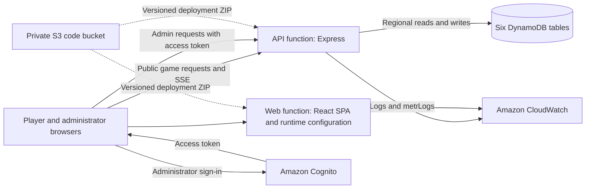
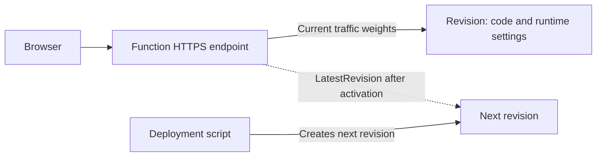
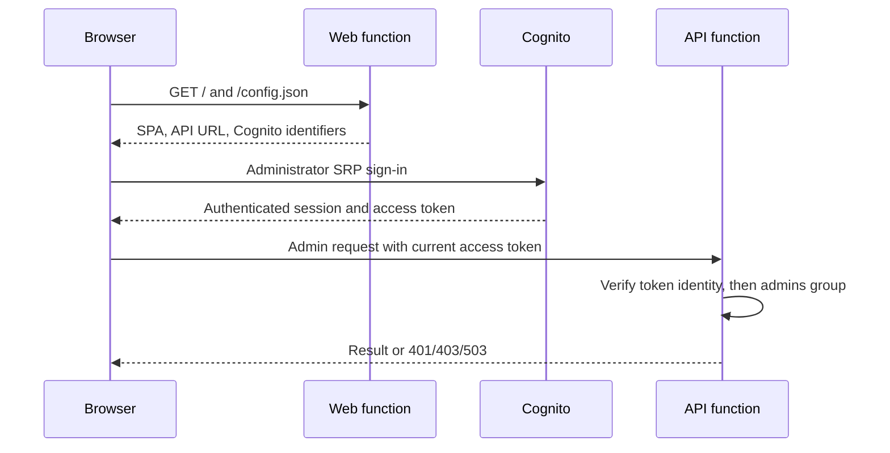

# ServerlessQ architecture and request flows

ServerlessQ uses two AWS Lambda Web Functions, regional DynamoDB tables, and
Cognito administrator authentication. The [diagram exports and editable
source](serverlessq-architecture.md) complement the request flows below.
Deployment and cleanup instructions are in the [sample guide](../README.md).

## System architecture



The browser calls each function's HTTPS endpoint directly. Separate functions
allow page loads and long-lived SSE streams to use independent capacity. The
web role permits logging; data access belongs to the API role.

All six tables—question-sets, questions, games, participants, answers, and
scores—live in `primary_region`. Additional function serving regions still
access those tables through `DDB_REGION`; there are no DynamoDB replicas.
Cognito token validation uses the configured user pool and public app client.
An invalid identity receives `401`; a valid identity without the `admins`
group receives `403`. Public routes remain anonymous.

## Function, revision, and endpoint



The default `home` endpoint follows the latest active revision. The optional
`global` endpoint uses a specified revision in configured serving regions.
Endpoint creation applies rate and execution-environment limits. Configuration
changes require a new revision; persisted game data does not.

Source: `scripts/deploy.sh`.

## Runtime configuration and authentication



The same built frontend can target different API endpoints through runtime
configuration. Cognito identifiers are public settings. The administrator
session uses session-scoped storage; admin calls fetch a current access token.
Exact-origin CORS controls browser access independently of token validation.
Signing keys are cached by the verifier. A key-fetch or configuration failure
fails closed with `503`; issued tokens may remain valid until their 15-minute
expiry after disabling a user or removing administrator membership.

Sources: `packages/web/index.js`, `packages/web/src/runtime-config.ts`,
`packages/api/src/middleware/adminAuth.ts`.

## Shared SSE poller and reconnects

```mermaid
sequenceDiagram
    participant A as Browser A
    participant B as Browser B
    participant API as API execution environment
    participant DDB as Regional DynamoDB
    A->>API: Open game leaderboard stream
    API->>API: Start game poller on first connection
    B->>API: Open same game stream
    loop While connections remain
        API->>DDB: Read game and leaderboard; settle due round
        DDB-->>API: Shared state
        API-->>A: State and leaderboard events
        API-->>B: Same events
    end
    Note over A,API: Stream interrupted or request times out
    A->>API: EventSource reconnects and opens replacement stream
```

One poller per game per execution environment broadcasts snapshots to that
environment's connections. Reads are shared across its browsers; they are not
one database request or one poller for the entire deployment. The poller stops
when its final connection closes.

The default polling interval is 1.5 seconds. When a stream is interrupted or
its request times out, the browser's EventSource reconnects. After repeated
failures, the browser falls back to polling. Persistent state lives in
DynamoDB, so a new stream can use a different execution environment.

Sources: `packages/api/src/sse.ts`, `packages/shared/src/config.ts`,
`packages/web/src/api/leaderboardStream.ts`, `packages/web/src/hooks/useLiveGame.ts`.

## Answers and round settlement

The server timestamps an answer, verifies the current question and open round,
and uses a conditional write to reject repeated submissions. A countdown
expiry, all players answering, or an administrator reveal can settle a round.
A conditional game update claims scoring, then the API applies per-player
score updates before publishing the reveal. These writes are not one atomic
transaction across all players; failure recovery remains a sample limitation.

Sources: `packages/api/src/routers/public.ts`,
`packages/api/src/services/round.ts`,
`packages/shared/src/repositories/answers.ts`,
`packages/shared/src/repositories/scores.ts`.
